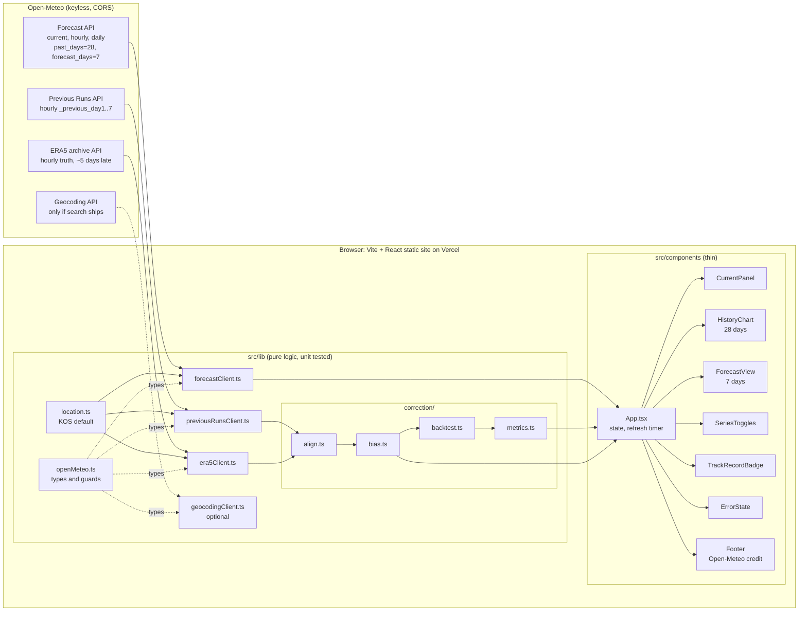
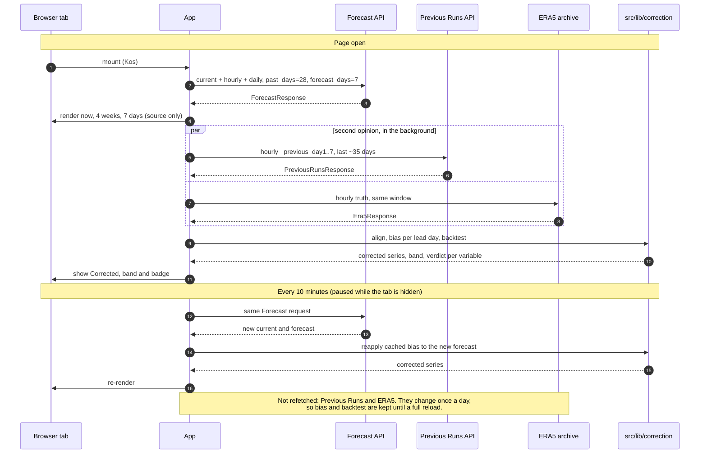
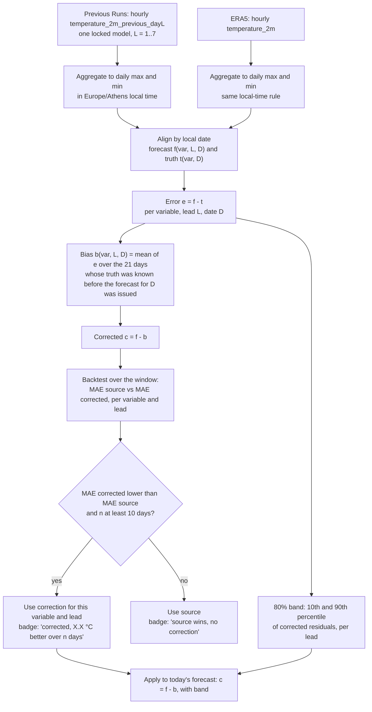

# Architecture

Status: draft for approval. No code follows until it is approved.

Weather Quick is a static single-page app. The browser calls Open-Meteo directly. There is no backend, no API key and no storage beyond the browser's memory.

## 1. Components and data flow



Rules the diagram encodes:

- Components never call `fetch` or do arithmetic on weather data. They render what `src/lib` returns.
- `openMeteo.ts` and `location.ts` are shared and change only in the architect window.
- Kos is fixed. Geocoding appears only if search fits the time budget, and every result shows country and region.

## 2. Load and refresh



Failure paths:

- Forecast fails: the page shows `ErrorState` with the API's `reason`.
- Previous Runs or ERA5 fails: the base dashboard stays, the badge says "second opinion unavailable" with the reason, and the Corrected toggle is disabled.
- On refresh failure the last good data stays on screen with a "last updated" time.

Load per visit: 3 calls, plus 1 every 10 minutes. Well under Open-Meteo's 600 a minute and 10,000 a day.

## 3. Second opinion: correction and backtest

Variables: daily max and min temperature (°C). Others only if time allows.



The no-look-ahead rule: for a forecast of date D at lead L, issued on D − L, the bias may only use dates whose ERA5 truth existed on D − L (that is, dates up to about D − L − 5, because of the ERA5 lag). A test changes all future truth and checks that past corrections stay identical.

## 4. File tree

```text
src/
  main.tsx                     React entry, mounts App
  App.tsx                      holds state, runs the 10-minute refresh, wires lib to components
  index.css                    layout, desktop grid and mobile stack
  components/
    CurrentPanel.tsx           "now": temperature, feels-like, wind, humidity, with units
    HistoryChart.tsx           past 28 days: daily max/min line chart
    ForecastView.tsx           next 7 days: chart + table, source and corrected, 80% band
    SeriesToggles.tsx          on/off: Source, Corrected, 80% band
    TrackRecordBadge.tsx       verdict per variable from the backtest
    ErrorState.tsx             API reason, retry button
    Footer.tsx                 "Weather data by Open-Meteo.com" (CC BY 4.0), last updated
  lib/
    openMeteo.ts               response types, isApiError, misalignedFields (shared, architect only)
    openMeteo.test.ts          fixtures match the types and are aligned
    location.ts                Place type and the KOS default (shared, architect only)
    forecastClient.ts(+test)   builds the Forecast URL, returns ForecastResponse or ApiError
    previousRunsClient.ts(+test)  builds the Previous Runs URL for the locked model
    era5Client.ts(+test)       builds the ERA5 URL for the backtest window
    geocodingClient.ts(+test)  optional: search with countryCode, shows country and region
    correction/
      align.ts(+test)          hourly to daily in local time, joins forecast and truth by date
      bias.ts(+test)           rolling bias per variable and lead, no look-ahead
      backtest.ts(+test)       replays the window, corrected vs source per day
      metrics.ts(+test)        MAE, n, percentile band, decision rule
    fixtures/                  real Open-Meteo responses used by the tests
```

## 5. Wireframes

Desktop (≥ 900 px):

```text
+--------------------------------------------------------------------------+
| Weather Quick        Kos, South Aegean, Greece          updated 23:10    |
+---------------------------+----------------------------------------------+
| NOW                       | NEXT 7 DAYS                                  |
|  17.4 °C  feels 16.0 °C   |  [x] Source  [x] Corrected  [x] 80% band     |
|  wind 22 km/h NW          |  °C                                          |
|  humidity 71 %            |  24|   ___----___      shaded = 80% band     |
|                           |  18|--/          \---  solid = corrected      |
| SECOND OPINION            |  12|                   dashed = source        |
| [badge] Max temp:         |     Thu Fri Sat Sun Mon Tue Wed              |
|  corrected, 0.8 °C better |  day  src max  ours max  80% range  gap      |
|  over 18 days             |  Thu  21.0     20.2      19.1-21.4  -0.8     |
|  Min temp: source wins    |  ...                                         |
+---------------------------+----------------------------------------------+
| PAST 4 WEEKS                                                             |
|  °C  daily max ----  daily min ....                                      |
|  24|  /\    /\__/\                                                       |
|  12|_/  \__/      \____                                                  |
|     28 Oct ............................................. 25 Nov          |
+--------------------------------------------------------------------------+
| Weather data by Open-Meteo.com (CC BY 4.0) · ERA5 truth via Open-Meteo   |
+--------------------------------------------------------------------------+
```

Mobile (< 900 px), one column in this order:

```text
+--------------------------+
| Weather Quick            |
| Kos, South Aegean, GR    |
+--------------------------+
| NOW  17.4 °C             |
| feels 16.0 · wind 22 NW  |
+--------------------------+
| [badge] Max: corrected,  |
| 0.8 °C better (18 days)  |
+--------------------------+
| NEXT 7 DAYS              |
| [Source][Corrected][80%] |
|  chart (full width)      |
|  Thu 20.2 (19.1-21.4)    |
|  Fri ...                 |
+--------------------------+
| PAST 4 WEEKS             |
|  chart (scroll-free)     |
+--------------------------+
| Data: Open-Meteo.com     |
| CC BY 4.0 · updated 23:10|
+--------------------------+
```

## 6. Open decisions

| Decision | Options | Trade-offs | Proposal |
| --- | --- | --- | --- |
| Chart library (one only) | **Recharts** | Declarative JSX, `Area` with a `[low, high]` range draws the band, responsive container. About 100 kB gzip. | **Recharts.** Readable in a live change during the call; the band is one component. |
| | uPlot | About 15 kB, very fast. Imperative API and a React wrapper by hand; band needs a plugin or a fill between two series. | |
| | Chart.js + react-chartjs-2 | Familiar. Two dependencies, canvas, band via `fill` between datasets. | |
| How the 80% band shows | **Shaded area on the chart + range in the table** | Visible at a glance and exact in numbers. Needs a legend line. | **Shaded + table.** |
| | Whiskers per day | Precise, but busy on 7 points × 2 series. | |
| | Text only ("19–21 °C") | Simplest, no visual sense of spread. | |
| Band method | **Empirical 10th/90th percentile of residuals** | No distribution assumption; noisy with n < 15. | **Empirical**, and hide the band when n < 10. |
| | Normal, ±1.28 σ | Smooth with small n; assumes symmetric errors. | |
| Bias window | 14 / **21** / 28 days | Shorter follows regime changes, longer is steadier. 21 leaves 10+ backtest days within the Previous Runs history we fetch. | **21 days.** |
| Locked model | **best_match (default)** | Same model as the base dashboard, matches the fixtures. Blend can change under us. | **best_match**, noted as a rough edge. |
| | ecmwf_ifs025 | One fixed model, cleaner science; differs from what the base shows. | |
| Decision rule | **MAE corrected < MAE source, n ≥ 10** | Simple and honest; small wins can be noise. | **This rule.** Margin test is roadmap. |
| | Require a margin (e.g. 0.2 °C) | Fewer false wins; one more number to defend. | |
| Refresh while tab hidden | **Pause, refresh on return** | Saves calls; shows a stale time until return. | **Pause.** |
| | Keep refreshing | Always fresh; wastes calls. | |

New dependency to approve now: the chart library only. Nothing else is planned.

## 7. Tests vs eye

| Checked by tests (vitest, `src/lib` only) | Checked by eye (Petros) |
| --- | --- |
| Fixtures match the types; time arrays align with every field | Layout on desktop and on a phone width |
| Each client builds a URL with exactly the brief's fields and parameters | Charts readable: axes, units, legend, colours |
| `ApiError` is detected and its `reason` passes through | Toggles turn series and band on and off |
| `align`: local-date aggregation, midnight edge, the 25 Oct DST change | Badge wording is true and short, including "source wins" |
| No look-ahead: changing future truth leaves past corrections identical | Error state appears when the network is off |
| `bias`, `backtest`, `metrics` on small hand-made series with known answers | Footer link to Open-Meteo works |
| Percentile band and the n ≥ 10 rule | Values plausible for Kos in late November (about 13–23 °C) |
| Refresh logic refetches the forecast only (pure scheduler function) | Refresh: "updated" time changes after 10 minutes |

No component tests: they would need Testing Library and jsdom, which are new dependencies. Ask first if wanted.

## 8. PR order and time

Used so far: 0:55 logged, plus about 0:15 for this document. Left: about 4:50.

```mermaid
gantt
  dateFormat HH:mm
  axisFormat %H:%M
  title Remaining budget (hours of work, not clock time)
  section Parallel
  PR step 4 UI base (ui window)            :a, 00:00, 75m
  PR step 5 correction + backtest          :b, 00:00, 105m
  section After both merge
  PR step 6 second-opinion UI              :c, after b, 45m
  section Architect
  Step 7 notes, ai logs, Vercel, rehearsal :d, after c, 40m
  Buffer                                   :e, after d, 25m
```



| PR | Window | Branch | Estimate | Depends on |
| --- | --- | --- | --- | --- |
| Step 4: UI base | ui | `feat/ui-base` | 1:15 | this doc approved |
| Step 5: correction + backtest | correction | `feat/second-opinion` | 1:45 | this doc approved |
| Step 6: second-opinion UI | ui | `feat/second-opinion-ui` | 0:45 | 4 and 5 merged |
| Step 7: NOTES, ai/, deploy, rehearsal | architect | `claude/...` | 0:40 | 6 merged |
| Buffer | | | 0:25 | |
| **Total** | | | **4:50** | |

Billed time counts each window's work, so steps 4 and 5 add up (3:00) even though they run side by side. If step 5 runs over, cut in this order: min temperature (keep max only), then the band, then geocoding (already optional).
