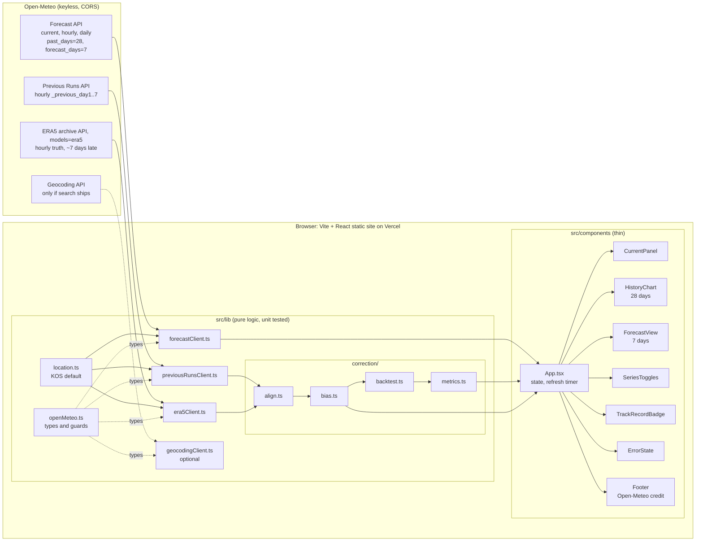
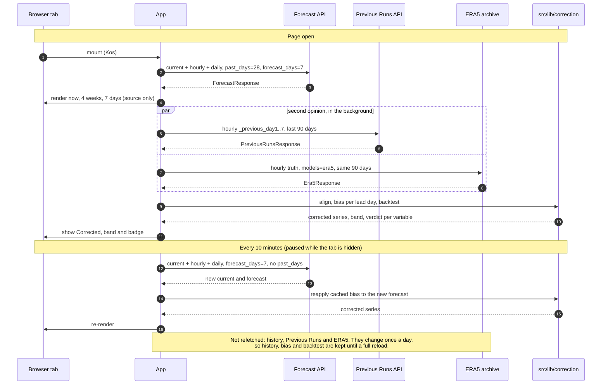
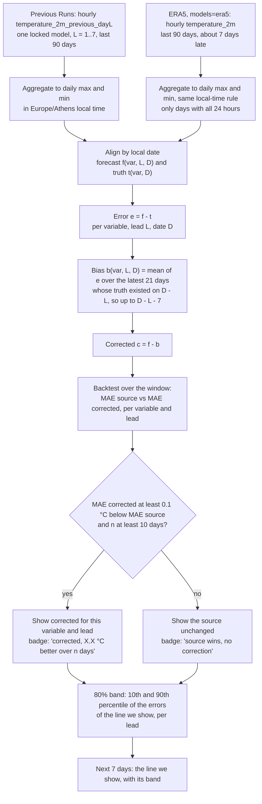

# Architecture

Status: draft for approval. No code follows until it is approved.

Weather Quick is a static single-page app. The browser calls Open-Meteo directly. There is no backend, no API key and no storage beyond the browser's memory.

## 1. Components and data flow



Rules the diagram encodes:

- Components never call `fetch` or do arithmetic on weather data. They render what `src/lib` returns.
- `openMeteo.ts` and `location.ts` are shared and change only with Petros's OK.
- Kos is fixed. Geocoding appears only if search fits the time budget, and every result shows country and region.

## 2. Load and refresh



Failure paths:

- Forecast fails: the page shows `ErrorState` with the API's `reason`.
- Previous Runs or ERA5 fails: the base dashboard stays, the badge says "second opinion unavailable" with the reason, and the Corrected toggle is disabled.
- On refresh failure the last good data stays on screen with a "last updated" time.

Load per visit: 3 requests, plus 1 every 10 minutes. Open-Meteo weighs each request by days and variables (`X-RateLimit-Cost`, measured on 2026-11-26): opening the page costs about 12.5 calls (Forecast 5.5, Previous Runs for 90 days 5.1, ERA5 for 90 days 1.9) and a 7-day refresh 2.2, against 600 a minute. A tab left open all day makes 144 refreshes, about 317 calls; repeating the full request would be 792.

## 3. Second opinion: correction and backtest

Variables: daily max and min temperature (°C). Others only if time allows.



The no-look-ahead rule: the forecast issued on day D − L (lead L for date D) is corrected only with truth that existed on D − L. ERA5 lags by 7 days (on 2026-11-26 the last full day was 19 November), so the bias uses dates up to D − L − 7. With the 5 days assumed before, the backtest would see 2 days that a live run would not have. A day counts only if ERA5 has all 24 hours: in the fixture, 20 November has 2 and stays out. A test changes all truth after D − L − 7 and checks that the correction for D stays identical.

## 4. File tree

```text
src/
  main.tsx                     React entry, mounts App
  App.tsx                      holds state, runs the 10-minute refresh, wires lib to components
  index.css                    layout, desktop grid and mobile stack
  components/
    CurrentPanel.tsx           "now": temperature, feels-like, wind, gusts, dew point, rain, with units
    HistoryChart.tsx           past 28 days: max/min chart, rain chart under it (mm, same dates)
    ForecastView.tsx           next 7 days: chart + table, source and corrected, 80% band
    SeriesToggles.tsx          on/off: Source, Corrected, 80% band
    TrackRecordBadge.tsx       verdict per variable from the backtest
    ErrorState.tsx             API reason, retry button
    Footer.tsx                 "Weather data by Open-Meteo.com" (CC BY 4.0), last updated
  lib/
    openMeteo.ts               response types, isApiError, misalignedFields (shared, change only with an OK)
    openMeteo.test.ts          fixtures match the types and are aligned
    location.ts                Place type and the KOS default (shared, change only with an OK)
    forecastClient.ts(+test)   builds the Forecast URL, returns ForecastResponse or ApiError
    days.ts(+test)             splits the daily series into the past 28 days and the next 7, by local date
    weatherCode.ts(+test)      WMO weather code to text, from the table in the Open-Meteo docs
    refresh.ts(+test)          what each request asks for: history on the first load, 7 days on a refresh
    previousRunsClient.ts(+test)  builds the Previous Runs URL for the locked model
    era5Client.ts(+test)       builds the ERA5 URL for the backtest window
    geocodingClient.ts(+test)  optional: search with countryCode, shows country and region
    correction/
      align.ts(+test)          hourly to daily in local time, joins forecast and truth by date
      bias.ts(+test)           rolling bias per variable and lead, no look-ahead
      backtest.ts(+test)       replays the window, corrected vs source per day
      metrics.ts(+test)        MAE, n, percentile band, decision rule
    fixtures/                  real Open-Meteo responses used by the tests
```

## 5. Wireframes

Visual details (colours, type, copy, chart styling) are in [ui-design.md](ui-design.md).

Desktop (≥ 900 px):

```text
+--------------------------------------------------------------------------+
| Weather Quick        Kos, South Aegean, Greece          updated 23:10    |
+---------------------------+----------------------------------------------+
| NOW                       | NEXT 7 DAYS                                  |
|  17.4 °C  feels 16.0 °C   |  [x] Source  [x] Corrected  [x] 80% band     |
|  wind 22 km/h NW          |  °C                                          |
|  dew point 11.8 °C        |  24|   ___----___      shaded = 80% band     |
|                           |  18|--/          \---  solid = corrected      |
| SECOND OPINION            |  12|                   dashed = source        |
| [badge] Max temp:         |     Thu Fri Sat Sun Mon Tue Wed              |
|  corrected, 0.8 °C better |  day  src max  ours max  80% range  gap      |
|  over 18 days             |  Thu  21.0     20.2      19.1-21.4  -0.8     |
|  Min temp: source wins    |  ...                                         |
+---------------------------+----------------------------------------------+
| PAST 4 WEEKS                                                             |
|  °C  daily max ----  daily min ....                                      |
|  24|  /\    /\__/\                                                       |
|  12|_/  \__/      \____                                                  |
|     28 Oct ............................................. 25 Nov          |
+--------------------------------------------------------------------------+
| Weather data by Open-Meteo.com (CC BY 4.0) · ERA5 truth via Open-Meteo   |
+--------------------------------------------------------------------------+
```

Mobile (< 900 px), one column in this order:

```text
+--------------------------+
| Weather Quick            |
| Kos, South Aegean, GR    |
+--------------------------+
| NOW  17.4 °C             |
| feels 16.0 · wind 22 NW  |
+--------------------------+
| [badge] Max: corrected,  |
| 0.8 °C better (18 days)  |
+--------------------------+
| NEXT 7 DAYS              |
| [Source][Corrected][80%] |
|  chart (full width)      |
|  Thu 20.2 (19.1-21.4)    |
|  Fri ...                 |
+--------------------------+
| PAST 4 WEEKS             |
|  chart (scroll-free)     |
+--------------------------+
| Data: Open-Meteo.com     |
| CC BY 4.0 · updated 23:10|
+--------------------------+
```

## 6. Decisions

Approved by Petros on 2026-11-26; the chosen option is in bold. Two proposals changed on approval: the decision rule needs a 0.1 °C margin, and the band comes from the errors of the line we show.

| Decision | Options | Trade-offs | Chosen |
| --- | --- | --- | --- |
| Chart library (one only) | **Recharts** | Declarative JSX, `Area` with a `[low, high]` range draws the band, responsive container. 137 KB gzip over React, 39 packages (measured on 3.11.1). | **Recharts 3.10.1**, exact version, loaded lazily. Readable in a live change during the call; the band is one component. Installed in the step 4 PR. |
| | uPlot | 23 KB gzip, 1 package, very fast. Imperative API and a React wrapper by hand; band needs a plugin or a fill between two series. | |
| | Chart.js + react-chartjs-2 | Familiar. 65 KB gzip, 3 packages, canvas, band via `fill` between datasets. | |
| How the 80% band shows | **Shaded area on the chart + range in the table** | Visible at a glance and exact in numbers. Needs a legend line. | **Shaded + table.** |
| | Whiskers per day | Precise, but busy on 7 points × 2 series. | |
| | Text only ("19–21 °C") | Simplest, no visual sense of spread. | |
| Band method | **Empirical 10th/90th percentile of the errors of the line we show** | No distribution assumption; noisy with n < 15. The source's errors when the source wins, so the band describes the line on screen. | **Empirical, from the shown line**, hidden when n < 10. |
| | Empirical, from the corrected errors only | The first draft. Describes the correction even when the page shows the source. | |
| | Normal, ±1.28 σ | Smooth with small n; assumes symmetric errors. | |
| Bias window | 14 / **21** / 28 days | Shorter follows regime changes, longer is steadier. 21 needs more history than ~35 days (next row). | **21 days.** |
| History for the backtest | ~35 days (the first draft of section 2) | 1 backtest day at lead 1 and none from lead 2: the 7-day ERA5 lag and the 21-day window use it up, so n ≥ 10 is never met and the correction never shows. Previous Runs counts as 2.0 calls. | |
| | **90 days** | 56 backtest days at lead 1, 50 at lead 7. 5.1 calls, 128 KB before compression. Crosses the 25 October clock change; both APIs answer with the same fixed +2 h, so they stay aligned. | **90 days.** |
| | 180 days (`open-meteo-brief.md`) | 146 to 140 days. 10.3 calls, 256 KB before compression. | |
| Truth for the backtest | **`models=era5`** | What every document and the footer promise. On 2026-11-26 the last full day was 19 November. Cell 37.0 N, 27.25 E (0.25°). Recent hours are `null`; the shared type allows it for ERA5 only. | **`models=era5`**, fixture replaced (28 August to 25 November). A day counts only with all 24 hours. |
| | Archive default (no `models`) | No lag, finer cell (36.872 N, 27.237 E), but it is not ERA5: 336 of 336 hours equal `ecmwf_ifs`, and it differs from ERA5 by 0.68 °C on average. The old `kos-era5.json` was fetched this way. | |
| Locked model | **best_match (default)** | Same model as the base dashboard, matches the fixtures. Blend can change under us. | **best_match**, noted as a rough edge. |
| | ecmwf_ifs025 | One fixed model, cleaner science; differs from what the base shows. | |
| Decision rule | MAE corrected < MAE source, n ≥ 10 | The first draft. Simple, but a win of 0.04 °C would show as "0.0 °C better". | |
| | **MAE corrected at least 0.1 °C below MAE source, n ≥ 10** | The badge never claims a win it cannot write with one decimal. One more number to defend. | **0.1 °C margin.** |
| Refresh while tab hidden | **Pause, refresh on return** | Saves calls; shows a stale time until return. | **Pause.** |
| | Keep refreshing | Always fresh; wastes calls. | |
| Helper files for step 4 | **`src/lib/days.ts`, `weatherCode.ts`, `refresh.ts`, each with a test** | Split past and next days, WMO code to text, what a refresh asks for. This is logic, so it belongs in `src/lib`, but `briefs/ui-base.md` lists only `forecastClient.ts`. | **Added to `briefs/ui-base.md`.** |
| | Logic inside components | No new files; breaks the thin-UI rule and has no tests. | |
| Rain in the 28-day chart | **Own small chart under temperature, with a mm axis** | Every value keeps its unit. A little more height. | **Own chart, same dates.** |
| | Bars in the temperature chart, 45% of its height (`ui-design.md`) | Compact, as in the mockup; the bars have no axis and no unit. | |
| Fonts | **System fonts** | Nothing to load, no third party. Looks less like the mockup. | **System fonts.** |
| | Space Grotesk and Inter (`ui-design.md`) | As in the mockup. Google Fonts sends each visitor's IP to a third party; self-hosting adds font files. | |

New dependency: Recharts 3.10.1 only, approved on 2026-11-26. Nothing else is planned.

## 7. Tests vs eye

| Checked by tests (vitest, `src/lib` only) | Checked by eye (Petros) |
| --- | --- |
| Fixtures match the types; time arrays align with every field | Layout on desktop and on a phone width |
| Each client builds a URL with exactly the brief's fields and parameters | Charts readable: axes, units, legend, colours |
| `ApiError` is detected and its `reason` passes through | Toggles turn series and band on and off |
| `align`: local-date aggregation, midnight edge, the 25 Oct DST change, days with fewer than 24 hours left out | Badge wording is true and short, including "source wins" |
| No look-ahead: changing truth after D − L − 7 leaves the correction for D identical | Error state appears when the network is off |
| `bias`, `backtest`, `metrics` on small hand-made series with known answers | Footer link to Open-Meteo works |
| Band from the shown line's errors, the n ≥ 10 rule and the 0.1 °C margin | Values plausible for Kos in late November (about 13–23 °C) |
| `refresh.ts`: the first load asks for the history, a refresh for 7 days only | Refresh: "updated" time changes after 10 minutes |

No component tests: they would need Testing Library and jsdom, which are new dependencies. Ask first if wanted.

## 8. PR order and time

Used so far: 2:20 of 6:00 (`docs/timelog.md`). Left: 3:40. The plan needed 4:50, so it does not fit by 1:10.

Proposed cuts, waiting for Petros's OK:

1. Step 4 shows the next 7 days as a table only. The 7-day chart is built once, in step 6, with source and corrected together.
2. Step 5 starts with the ERA5 fixture and the nullable type already done in this PR.
3. Confidence is "± X.X °C" per lead: the backtest MAE of the line we show, in the table and the badge. No shaded 80% band, so no percentiles in step 5 and no area or legend in step 6.
4. Step 6 has no series toggles: both lines are always on.
5. Step 7 keeps one rehearsal of a live change.

| PR | Branch | Estimate | With the cuts | Depends on |
| --- | --- | --- | --- | --- |
| Step 4: UI base | `feat/ui-base` | 1:15 | 1:00 | this doc approved and merged |
| Step 5: correction + backtest | `feat/second-opinion` | 1:45 | 1:25 | 4 merged |
| Step 6: second-opinion UI | `feat/second-opinion-ui` | 0:45 | 0:25 | 5 merged |
| Step 7: NOTES, ai/, deploy, rehearsal | `feat/wrap-up` | 0:40 | 0:35 | 6 merged |
| Buffer | | 0:25 | 0:15 | |
| **Total** | | **4:50** | **3:40** | |

One agent takes the steps in this order, one PR each. If step 5 still runs over, the next cut is min temperature (keep max only).
